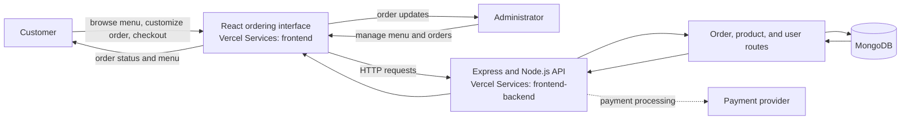
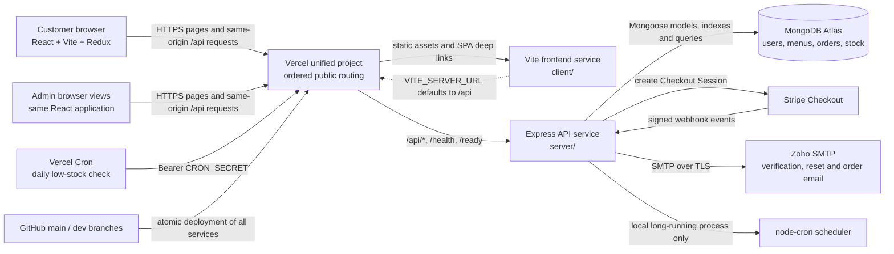
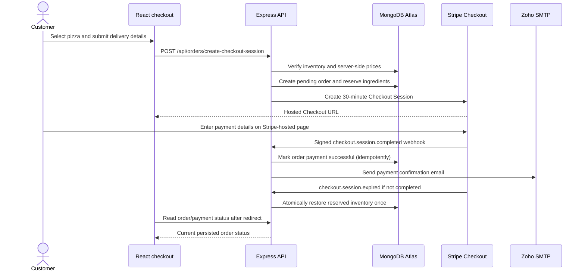

# Pizza Delivery System App - MERN

## Architecture



> Pizza Delivery System App (MERN - MongoDB, Express, React, Node.js) is a comprehensive web application that enables users to customize and order pizzas online. This project showcases a full-stack development approach with a focus on user experience, functionality, and security. The app includes a user-friendly frontend interface for ordering pizzas, an admin dashboard for managing orders and inventory, and a secure backend server for processing orders and payments.

<br />
<div align="center">
  <p align="center">
    <br />
    <a href="https://github.com/itxSaaad/pizza-palette-app-mern-OIBSIP-task-1">
    <strong>Explore the docs »</strong></a>
    <br />
    <br />
    <a href="https://pizza-palette-app-mern.vercel.app/">View Demo</a>
    ·
    <a href="https://github.com/itxSaaad/pizza-palette-app-mern-OIBSIP-task-1/issues">Report Bug</a>
    ·
    <a href="https://github.com/itxSaaad/pizza-palette-app-mern-OIBSIP-task-1/issues">Request Feature</a>
  </p>
</div>

[![Contributors][contributors-shield]][contributors-url]
[![Forks][forks-shield]][forks-url]
[![Stargazers][stars-shield]][stars-url]
[![Issues][issues-shield]][issues-url]
[![MIT License][license-shield]][license-url]

## Live Preview Project

[Live Preview](https://pizza-palette-app-mern.vercel.app/)

## Features

### User Features
- ✅ **User Authentication:** Secure registration and login with JWT tokens
- ✅ **Email Verification:** Email-based account verification system
- ✅ **Custom Pizza Creation:** Build your own pizza with custom ingredients
- ✅ **Pizza Browsing:** View all available pizzas with details
- ✅ **Shopping Cart:** Add items, update quantities, remove items
- ✅ **Secure Checkout:** Stripe-hosted payment integration
- ✅ **Order History:** Track past and current orders
- ✅ **Order Status Tracking:** Real-time order status updates
- ✅ **Profile Management:** Update user information
- ✅ **Password Reset:** Forgot password functionality

### Admin Features
- ✅ **Admin Authentication:** Secure admin login with approval system
- ✅ **Dashboard Analytics:** View key metrics (users, orders, revenue)
- ✅ **User Management:** View and manage all users
- ✅ **Pizza Management:** Full CRUD operations on pizzas
- ✅ **Inventory Management:** Track and update ingredient stock
- ✅ **Order Management:** View and update all orders
- ✅ **Order Status Updates:** Change order status with email notifications
- ✅ **Low Stock Alerts:** Automatic alerts for low inventory
- ✅ **Admin Approval System:** New admins require approval

### Technical Features
- ✅ **Enterprise Error Handling:** Standardized API error responses with codes
- ✅ **Centralized Constants:** Single source of truth for enums and types
- ✅ **Email Notifications:** Automated emails for orders and account actions
- ✅ **Inventory Deduction:** Automatic stock updates on orders
- ✅ **Payment Verification:** Stripe webhook signature verification
- ✅ **Responsive Design:** Mobile-first, works on all devices
- ✅ **Security:** JWT auth, password hashing, input validation, rate limiting

## Documentation

📚 **[Complete Documentation](./docs/README.md)**

### Quick Links

- **[Setup Guide](./docs/SETUP.md)** - Complete installation and configuration
- **[API Reference](./docs/API.md)** - All API endpoints with examples
- **[Architecture](./docs/ARCHITECTURE.md)** - System design and data flows
- **[Error Handling](./docs/ERROR_HANDLING.md)** - Error handling patterns
- **[Constants](./docs/CONSTANTS.md)** - Constants and enums reference
- **[Testing](./docs/TESTING.md)** - Testing guide with test credentials
- **[Deployment](./docs/DEPLOYMENT.md)** - Deploy to Vercel (production)
- **[Contributing](./docs/CONTRIBUTING.md)** - Contribution guidelines
- **[Changelog](./docs/CHANGELOG.md)** - Version history

### Quick References

- **[Test Credentials](./TEST_CREDENTIALS.md)** - Login credentials for testing
- **[Stripe Setup](./docs/STRIPE_SETUP.md)** - Payment gateway configuration

---

## Tech Stack

### Frontend
- **React 18** - UI library
- **Vite 4** - Build tool and dev server
- **Redux Toolkit** - State management
- **React Router v6** - Client-side routing
- **Tailwind CSS** - Utility-first CSS framework
- **Axios** - HTTP client
- **React Icons** - Icon library

### Backend
- **Node.js** - JavaScript runtime
- **Express.js** - Web framework
- **MongoDB** - NoSQL database
- **Mongoose** - MongoDB ODM
- **JWT** - Authentication
- **bcryptjs** - Password hashing
- **express-validator** - Input validation
- **Nodemailer** - Email sending
- **Stripe SDK** - Payment processing

### Security & Middleware
- **Helmet** - Security headers
- **express-mongo-sanitize** - NoSQL injection prevention
- **express-rate-limit** - Rate limiting
- **CORS** - Cross-origin resource sharing

### Deployment
- **Vercel Services** - One project deploys the Vite frontend and Express API together
- **MongoDB Atlas** - Cloud database
- **GitHub** - Version control and CI/CD

---

## Architecture

### Application and Service Map



The public `/api` path is rewritten to Express before the frontend catch-all. Express keeps the `/api` prefix, so its mounted routes and browser URLs agree. The frontend and backend ship together in the unified Vercel project; preview deployments use the same routing shape as production. Local development runs Vite and Express separately, with the client API base configured as `http://localhost:5000/api` or same-origin `/api`.

### Customer checkout and payment confirmation



Stripe secret keys stay on the server. The browser is redirected to Stripe-hosted Checkout; order payment success is based on verified webhook delivery, not only the browser return URL. Abandoned sessions expire after 30 minutes and their ingredient reservation is restored by the expiration webhook. In production the daily stock-alert job is invoked through Vercel Cron and a bearer secret; local long-running development uses `node-cron`.

### Key Design Patterns

- **RESTful API** - Standard REST architecture
- **JWT Authentication** - Stateless token-based auth
- **Redux State Management** - Centralized state
- **Error Handling** - Standardized error responses with codes
- **Constants Management** - Duplicated constants (frontend/backend)
- **Middleware Pipeline** - Modular request processing

See [Architecture Documentation](./docs/ARCHITECTURE.md) for data models, request middleware, authentication, service boundaries, deployment behavior, and operational details.

---

## Error Handling

Version 2.0.0 introduces enterprise-grade error handling:

### Standardized Error Response
```json
{
  "success": false,
  "error": {
    "code": "VALIDATION_ERROR",
    "message": "User-friendly error message",
    "details": [
      { "field": "email", "message": "Email is required" }
    ],
    "timestamp": "2026-02-22T...",
    "path": "/api/users/register",
    "requestId": "req_unique_id"
  }
}
```

### Features
- **Error Codes** - Machine-readable codes (e.g., `AUTH_1001`, `VALIDATION_3001`)
- **Field-Level Details** - Specific validation errors per field
- **Request Tracking** - Unique request IDs for debugging
- **User-Friendly Messages** - Clear, actionable error messages

See [Error Handling Guide](./docs/ERROR_HANDLING.md) for complete reference.

## Getting Started

> **📖 For detailed setup instructions, see the [Setup Guide](./docs/SETUP.md)**

### Prerequisites

- **Node.js** (v16 or higher) - [Download](https://nodejs.org/)
- **MongoDB** - Local installation or [MongoDB Atlas](https://www.mongodb.com/cloud/atlas) account
- **Stripe Account** - [Sign up](https://dashboard.stripe.com/register) for test keys (see [Stripe Setup Guide](./docs/STRIPE_SETUP.md))

### Quick Start

1. **Clone the repository**

   ```sh
      git clone git@github.com:itxSaaad/pizza-palette-app-mern-OIBSIP-task-1.git
      cd pizza-palette-app-mern-OIBSIP-task-1
   ```

2. **Install dependencies**

   ```sh
      pnpm install
   ```

3. **Configure environment variables**

   Configure local environment variables using the names in the tracked example templates. Keep credentials private and out of commits.

   **Required variables:** See [Setup Guide](./docs/SETUP.md#environment-configuration) for complete list

4. **Seed the database**

   ```sh
   pnpm data:import
   ```

   **Test Credentials:** See [TEST_CREDENTIALS.md](./TEST_CREDENTIALS.md) for login details

5. **Start the application**

   ```sh
      # Run both server and client
      pnpm dev

      # Run server only
      pnpm server

      # Run client only
      pnpm client
   ```

6. **Access the application**

   - **Frontend:** [http://localhost:5173](http://localhost:5173)
   - **Backend API:** [http://localhost:5000](http://localhost:5000)

7. **Login with test credentials**

   - **Admin:** `admin1@pizzapalette.com` / `Admin@123456`
   - **User:** `john@example.com` / `User@123456`

> **📖 For troubleshooting, see [Setup Guide - Troubleshooting](./docs/SETUP.md#troubleshooting)**

---

## API Documentation

Complete API documentation with request/response examples:

### Base URL
- **Development:** `http://localhost:5000/api`
- **Production:** `https://your-backend.vercel.app/api`

### Authentication
Most endpoints require JWT token in Authorization header:
```http
Authorization: Bearer <token>
```

### Endpoint Categories
- **User Endpoints** - Registration, login, profile management
- **Pizza Endpoints** - CRUD operations on pizzas
- **Order Endpoints** - Order creation and tracking
- **Inventory Endpoints** - Ingredient management
- **Admin Endpoints** - Admin authentication and approval
- **Analytics Endpoints** - Dashboard statistics

**[View Complete API Reference →](./docs/API.md)**

---

## Testing

### Test Credentials

**Admin Account:**
```
Email: admin1@pizzapalette.com
Password: Admin@123456
```

**User Account:**
```
Email: john@example.com
Password: User@123456
```

### Stripe Test Cards

**Successful Payment:**
```
Card: 4242 4242 4242 4242
CVV: Any 3 digits
Expiry: Any future date
```

**Failed Payment:**
```
Card: 4000 0000 0000 0002
```

**[View Complete Testing Guide →](./docs/TESTING.md)**

---

## Deployment

### Vercel Deployment (Recommended)

1. **Fork this repository**
2. **Import to Vercel** as one Services project for the frontend and backend
3. **Configure environment variables** in Vercel dashboard
4. **Deploy** with auto-deploy on push

**[View Complete Deployment Guide →](./docs/DEPLOYMENT.md)**

### Environment Setup

**Backend (Vercel):**
- Set the server variables listed in [the deployment guide](./docs/DEPLOYMENT.md)
- Match `FRONTEND_URL` to the deployment domain

**Frontend (Vercel):**
- Set `VITE_SERVER_URL=/api` and `VITE_CLIENT_URL` to the deployment domain
- No Stripe configuration is needed on the frontend — checkout redirects to a Stripe-hosted page, the client never handles a publishable key or card details directly

---

## Project Structure

```
pizza-palette-app-mern/
├── client/                 # React frontend
│   ├── src/
│   │   ├── components/    # Reusable components
│   │   ├── screens/       # Page components
│   │   ├── redux/         # Redux store and slices
│   │   ├── constants/     # Frontend constants
│   │   └── utils/         # Utility functions
│   └── package.json
├── server/                 # Express backend
│   ├── controllers/       # Route controllers
│   ├── schemas/           # Mongoose models
│   ├── routes/            # API routes
│   ├── middlewares/       # Custom middleware
│   ├── validators/        # Input validation
│   ├── constants/         # Backend constants
│   ├── utils/             # Utility functions
│   └── package.json
├── docs/                   # Documentation
│   ├── README.md          # Docs index
│   ├── SETUP.md           # Setup guide
│   ├── API.md             # API reference
│   └── ...                # More guides
├── README.md              # This file
├── TEST_CREDENTIALS.md    # Test accounts
└── docs/STRIPE_SETUP.md   # Stripe config
```

---

## Version 2.0.0 - What's New

### Enterprise Features
- ✨ Standardized error handling with error codes
- ✨ Centralized constants management
- ✨ Enhanced validation with field-level details
- ✨ Request tracking with unique IDs
- ✨ Comprehensive documentation suite

### Improvements
- 🔄 Updated seed data with stronger passwords
- 🔄 Constants integrated in schemas and validators
- 🔄 Enhanced email templates with action links
- 🔄 Improved frontend error display
- 🔄 Updated UI components to use constants

### Documentation
- 📚 10 comprehensive documentation files
- 📚 Architecture diagrams
- 📚 Complete API reference
- 📚 Testing guide with credentials
- 📚 Deployment guide for Vercel

**[View Complete Changelog →](./docs/CHANGELOG.md)**

## Contributing

Contributions are what make the open-source community such an amazing place to be learn, inspire, and create. Any contributions you make are **greatly appreciated**.

If you have a suggestion that would make this better, please fork the repo and create a pull request. You can also simply open an issue with the tag "enhancement".
Don't forget to give the project a star! Thanks again!

1. Fork the repo
2. Clone the project
3. Create your feature branch (`git checkout -b feature/AmazingFeature`)
4. Commit your changes (`git commit -m "Add some AmazingFeature"`)
5. Push to the branch (`git push origin feature/AmazingFeature`)
6. Open a pull request

## Contact

- Twitter: [@itxSaaad](https://twitter.com/itxSaaad)
- LinkedIn: [@itxSaaad](https://www.linkedin.com/in/itxsaaad/)
- Portfolio: [Muhammad Saad Faisal](https://codesbysaaad.tech/)
- Email: [saadstudent.cs@gmail.com](mailto:saadstudent.cs@gmail.com)

## License

Distributed under the MIT License. See `LICENSE` for more information.

## Support

Give ⭐️ if you like this project!

<a href="https://www.buymeacoffee.com/itxSaaad"></a>

<!-- MARKDOWN LINKS & IMAGES -->

[contributors-shield]: https://img.shields.io/github/contributors/itxsaaad/pizza-palette-app-mern-OIBSIP-task-1.svg?style=for-the-badge
[contributors-url]: https://github.com/itxsaaad/pizza-palette-app-mern-OIBSIP-task-1/graphs/contributors
[forks-shield]: https://img.shields.io/github/forks/itxsaaad/pizza-palette-app-mern-OIBSIP-task-1.svg?style=for-the-badge
[forks-url]: https://github.com/itxsaaad/pizza-palette-app-mern-OIBSIP-task-1/network/members
[stars-shield]: https://img.shields.io/github/stars/itxsaaad/pizza-palette-app-mern-OIBSIP-task-1.svg?style=for-the-badge
[stars-url]: https://github.com/itxsaaad/pizza-palette-app-mern-OIBSIP-task-1/stargazers
[issues-shield]: https://img.shields.io/github/issues/itxsaaad/pizza-palette-app-mern-OIBSIP-task-1.svg?style=for-the-badge
[issues-url]: https://github.com/itxsaaad/pizza-palette-app-mern-OIBSIP-task-1/issues
[license-shield]: https://img.shields.io/github/license/itxsaaad/pizza-palette-app-mern-OIBSIP-task-1.svg?style=for-the-badge
[license-url]: https://github.com/itxsaaad/pizza-palette-app-mern-OIBSIP-task-1/blob/main/LICENSE.md

## Vercel Deployment
Vite client client/ + Express API server/index.js. Set Vercel framework to Services and VITE_SERVER_URL to this origin plus /api. Configure database/payment environment values in Vercel.
See the repository-root [vercel.json](./vercel.json) for build roots and routing. Configure private values in Vercel Project Settings; never commit secrets.

